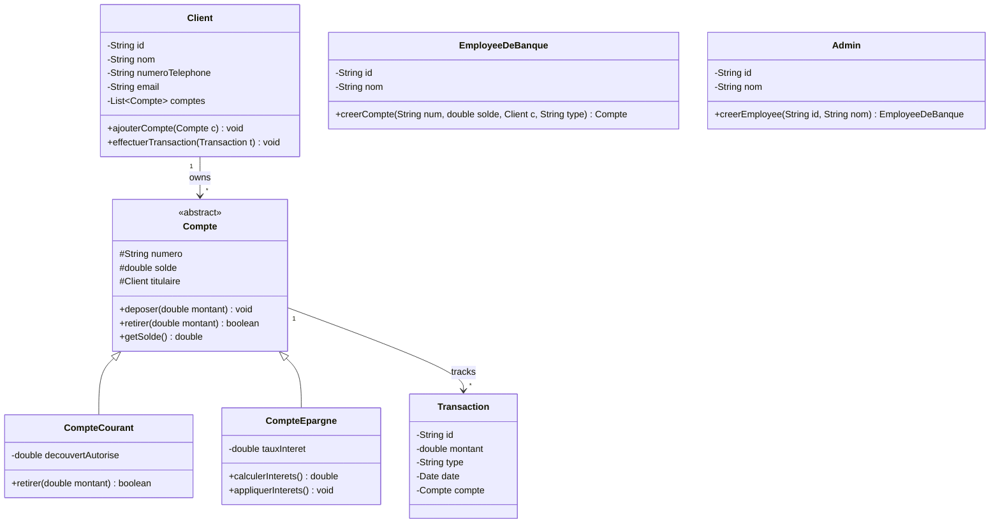

# Banking System Application

<p align="center">
  
  
  
  
  
</p>

A full-stack banking management system built in pure **Java** using Object-Oriented Design principles derived from formal **UML modeling**. The application features an embedded Java HTTP server, a RESTful JSON backend, and a modern single-page web interface providing distinct portals for **Clients**, **Bank Employees**, and **Administrators**.

---

## Features

- **Multi-Role Portals**:
  - **Client Portal**: View account balances, execute real-time deposits and withdrawals, view transaction histories.
  - **Employee Portal**: Onboard new clients, open new checking or savings accounts, manage client portfolios.
  - **Administrator Portal**: Oversee operations, register and manage bank employees and administrators.
- **Comprehensive Account Management**:
  - **CompteCourant (Checking Account)**: Supports overdraft authorization limits (`decouvertAutorise`).
  - **CompteEpargne (Savings Account)**: Includes interest rate calculation (`tauxInteret`) and interest application.
- **Transaction Processing**:
  - Auditable transaction records tracking type (`DEPOT` / `RETRAIT`), amount, timestamps, and target accounts.
- **Zero-Dependency Architecture**:
  - Built strictly on Core Java (`com.sun.net.httpserver.HttpServer`) without requiring Maven, Gradle, Spring, or external web servers.
- **Interactive Web Interface**:
  - Responsive single-page application served directly by the embedded Java HTTP server.

---

## Domain Architecture (UML Model)



---

## Project Structure

```text
pjr java/
├── src/
│   ├── model/                         # Domain Entities & Business Logic
│   │   ├── Admin.java                 # Administrator class
│   │   ├── Client.java                # Client model & account operations
│   │   ├── Compte.java                # Abstract base account class
│   │   ├── CompteCourant.java         # Checking account with overdraft
│   │   ├── CompteEpargne.java         # Savings account with interest rates
│   │   ├── EmployeeDeBanque.java      # Bank employee management class
│   │   └── Transaction.java           # Transaction processing record
│   ├── server/                        # Embedded HTTP Server & REST API
│   │   └── SimpleHttpServer.java      # Built-in Java HttpServer & API handlers
│   └── BankingSystemMain.java         # Standalone console simulation runner
├── web/                               # Web Frontend Assets
│   ├── index.html                     # Single-Page Application interface
│   ├── styles.css                     # Responsive styling & themes
│   └── script.js                      # AJAX client & DOM interaction
├── run_app.bat                        # Windows 1-click build and start script
├── .gitignore                         # Git exclusion rules
└── README.md                          # Project documentation
```

---

## REST API Endpoints

The embedded Java HTTP server provides the following endpoints:

| Endpoint | Methods | Description |
| :--- | :--- | :--- |
| `/` | `GET` | Serves web frontend files (`index.html`, `styles.css`, `script.js`) |
| `/api/clients` | `GET`, `POST` | Retrieve all clients or create a new client |
| `/api/accounts` | `GET`, `POST` | Retrieve all accounts or open a new account |
| `/api/transactions` | `GET`, `POST` | View transactions or execute deposits/withdrawals |
| `/api/employees` | `GET`, `POST` | List bank employees or onboard a new employee |
| `/api/admins` | `GET`, `POST` | List or authenticate administrators |

---

## Default Demo Credentials

| Role | Identifier (ID) | Authentication Key |
| :--- | :--- | :--- |
| **Administrator** | `A001` | Name: `Admin` |

> [!TIP]
> After logging in as **Admin (`A001`)**, you can create employees. Employees can then log in to register clients and open accounts.

---

## Getting Started

### Prerequisites

- [Java Development Kit (JDK) 8 or higher](https://www.oracle.com/java/technologies/downloads/) (JDK 17+ recommended)
- `javac` and `java` added to your system `PATH`

### Option 1: 1-Click Launch (Windows)

Simply double-click [`run_app.bat`](run_app.bat) or run it from Command Prompt / PowerShell:
```cmd
run_app.bat
```

### Option 2: Manual Terminal Execution

1. **Compile all Java classes**:
   - **Windows**:
     ```cmd
     if not exist bin mkdir bin
     javac -d bin src\model\*.java src\server\*.java src\*.java
     ```
   - **macOS / Linux**:
     ```bash
     mkdir -p bin
     javac -d bin src/model/*.java src/server/*.java src/*.java
     ```

2. **Start the Embedded Server**:
   ```bash
   java -cp bin server.SimpleHttpServer
   ```

3. **Open the Web Application**:
   Navigate your browser to:
   ```text
   http://localhost:8080
   ```

### Option 3: Backend Console Simulation

To run the standalone OOP demonstration without the HTTP server:
```bash
java -cp bin BankingSystemMain
```

---

## Contributing

Contributions and enhancements are welcome!

1. Fork the Project
2. Create your Feature Branch (`git checkout -b feature/NewFeature`)
3. Commit your Changes (`git commit -m 'Add NewFeature'`)
4. Push to the Branch (`git push origin feature/NewFeature`)
5. Open a Pull Request

---

## License

This project is licensed under the [MIT License](LICENSE).
